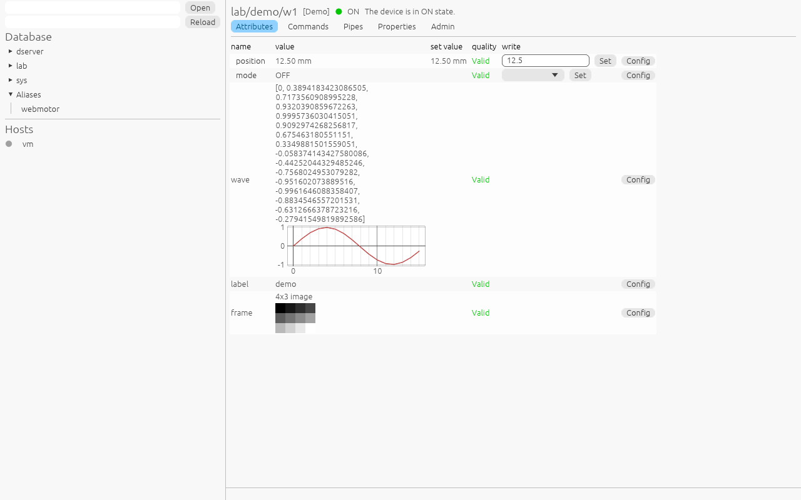

# TRust Browser — device browser and Starter interface

`trust-browser` (`apps/browser`) is written in Rust with **egui / eframe**:
a native desktop application, and the same code in a web page (WebAssembly).
It talks to a control system only through `DeviceProxy`, so it works over
every transport natively, and over WebSocket in a web page.

```sh
cargo run -p trust-browser -- localhost:10000        # or $TANGO_HOST
cargo run -p trust-browser --bin DemoServer -- <instance>   # the Demo devices registered for DemoServer/<instance>
apps/browser/web/build.sh                                    # the web page into apps/browser/web/pkg
python3 -m http.server -d apps/browser/web 8080              # then open http://localhost:8080/?db=<TANGO_HOST>
```

In a web page the browser reaches the Database and the devices over
WebSocket, which servers built with the `ws` feature accept on their
`tcp://` and `auto://` ports (TRANSPORTS.md §3.4); devices served only on
ZeroMQ, gRPC or Zenoh are out of reach there.
Every form is **inferred from the device's interface** (`CmdInfo`, `AttrInfo`,
`PipeInfo`, `PropInfo`), so no device class needs GUI code.

## 1. Layout

```
┌───────────────┬─────────────────────────────────────────────────────────┐
│ Database      │  sys/tg/1   [TgTest]   ● ON   "The device is in ON…"    │
│ ▸ dserver     │ ┌ Attributes ┬ Commands ┬ Pipes ┬ Properties ┬ Admin ┐   │
│ ▾ sys         │ │ name         value        unit  quality   write     │   │
│   ▾ tg        │ │ double_scalar 12.50       mm    VALID   [____] [Set]│   │
│     ● 1       │ │ long_spectrum [1, 2, 3]         VALID   ⎯ plot      │   │
│ ▸ tango       │ │ short_image   2×2 ▦             VALID               │   │
│               │ └──────────────────────────────────────────────────────┘   │
│ Hosts         │                                                          │
│ ▸ host-a  ●   │  Event log / errors                                      │
└───────────────┴─────────────────────────────────────────────────────────┘
```

* **Left panel: Database tree.** domain → family → member
  (`DbGetDeviceDomainList`, `…FamilyList`, `…MemberList`), aliases, and a
  filter box (wildcards). Each leaf shows an exported/not-exported dot
  (`DbGetDeviceInfo`). Without a Database, a URL box opens a device directly
  (`grpc://host:50051/sys/tg/1`, `tango://host:port/dev#dbase=no`).
* **Hosts section** (Starter interface, §4): hosts from `DbGetHostList`, each
  with its Starter's `HostState` colour.
* **Device panel**: header (name, class, State as a colour, Status), then
  tabs.

## 2. Generic forms

Every widget comes from metadata alone, through one pure function per
type, so the rules below can be unit-tested without a GUI:

| Data type / format | Display | Input widget |
|---|---|---|
| `Void` | — | none (command button only) |
| `Boolean` | true / false | checkbox |
| integer types | number with `format` | drag value clamped to the type range and to `[min_value, max_value]` |
| `Float`, `Double` | number with `format` and `unit` | text field parsed as float, with range check |
| `String` | text | single-line text (multi-line if it contains `\n`) |
| `State` | coloured state name (Tango colours) | combo box of the 14 states |
| `DevEnum` (Short + `enum_labels`) | label | combo box of the labels |
| `Encoded` | format + byte count, hex preview | not writable from the GUI |
| `*Array`, SPECTRUM | inline list; plot (egui_plot) for numbers | comma-separated text, element-wise validation |
| IMAGE | dimensions + greyscale heat map | not writable from the GUI |
| `LongStringArray`, `DoubleStringArray` | two lists | two comma-separated fields |
| Pipe blob | tree of key → value | JSON editor for writable pipes |

* **Attributes tab**: one row per attribute: name (tooltip = description and
  label), read value, `w_value`, unit, quality colour (VALID green, ALARM red,
  WARNING orange, CHANGING blue, INVALID grey), and a write widget for
  `WRITE`/`READ_WRITE` attributes. Values refresh by **CHANGE events** when the
  attribute supports them, otherwise by polling every second (configurable).
  Clicking a numeric attribute opens a trend plot.
* **Commands tab**: the command list with `in_type`/`out_type` and their
  descriptions, the input widget for `in_type`, an *Execute* button and the
  result rendered by the `out_type` rule. Errors show the full `DevFailed`
  stack.
* **Pipes tab**: read/refresh, and a write editor for writable pipes.
* **Properties tab**: device properties from the Database with the
  `PropInfo` description and default (`QueryWizardDevProperty`); edit, add,
  delete, and show the history (`DbGetDevicePropertyHist`).
* **Attribute config dialog**: the editable properties of `AttrInfo`
  (label, unit, format, limits, alarms, event thresholds) → ATTRIBUTE SET
  CONFIG.
* **Admin tab**: black box (DEVICE BLACKBOX), device info, polling status and
  configuration (`DevPollStatus`, `AddObjPolling`, …), logging level, Init,
  restart (`DevRestart` on the admin device).

## 3. Interaction rules

* Network calls never block the UI: each request runs on a tokio runtime
  owned by the app and its result comes back through a channel the UI drains
  every frame (`ctx.request_repaint()` on arrival).
* A failed call keeps the last value, greys it out, and logs the error in the
  bottom panel.
* Writes ask for confirmation when the value is outside
  `[min_alarm, max_alarm]`.

## 4. Starter interface (Astor-like)

* **Hosts view**: one row per host: Starter state (`HostState`), counts of
  running/stopped servers. Hosts without a Starter show "no Starter".
* **Host panel**: servers grouped by startup level (from the `Servers`
  attribute, refreshed by its CHANGE events), each with a state light
  (running / starting / stopped / not controlled) and buttons
  *Start* (`DevStart`), *Stop* (`DevStop`), *Kill* (`HardKillServer`),
  *Log* (`DevReadLog`, shown in a scrollable window), and per level
  *Start level* / *Stop level* (`DevStartAll` / `DevStopAll`).
* **Server panel**: its devices and classes (`QueryDevice` on its admin
  device); opening a device switches to the device panel.
* **Server registration**: a dialog to declare a new server on a host
  (`DbAddServer`, `DbPutServerInfo` with level and controlled flag), so that
  the Starter can start it.

## 5. Tests

* The type → widget and text → `Value` rules are pure functions with unit
  tests for every data type, including range errors.
* UI tests with `egui_kittest` run the app headless against a TgTest server,
  a Database and a Starter: open a device from the tree, write an attribute,
  execute a command, start and stop a server from the host panel. They
  assert on the accessibility tree, not on pixels.

## 6. Status

Implemented as above, with these differences:

* Values without CHANGE events refresh every second (fixed period).
* Clicking a numeric scalar attribute opens its trend (the last 1000 values,
  from events or polling); clicking again closes it.
* IMAGE attributes show as a greyscale heat map (smallest value black,
  largest white).
* Aliases are a section of the tree; properties have a *History* window
  (`DbGetDevicePropertyHist`).
* Writable pipes are edited as JSON (the blob read last is the template).
* Text is plain ASCII/Latin (state and quality lights are drawn shapes), so
  any font renders it and the headless tests need no extra font.
* The web build (wasm32) runs the same app over WebSocket; `?db=host:port`
  picks the Database (default: the page's host, port 10000).

  

Tests: `form.rs` unit tests (widgets, texts, parsing with range errors, round
trips, heat maps), `app.rs` unit tests (tree filter, Starter lines, property
history), and two `egui_kittest` tests in `tests/ui.rs` against a live
Database, a `DemoServer` and a Starter:

* device: open it from an alias and from the tree; read and write attributes
  (including the alarm-limit confirmation and a `max_value` refusal); see an
  image heat map; open a trend, watch it grow, close it; run a command; read a
  pipe, the properties and a property history; show the black box;
* Starter: start, stop and read the log of a server from the host panel, list
  its devices, register a new server.
